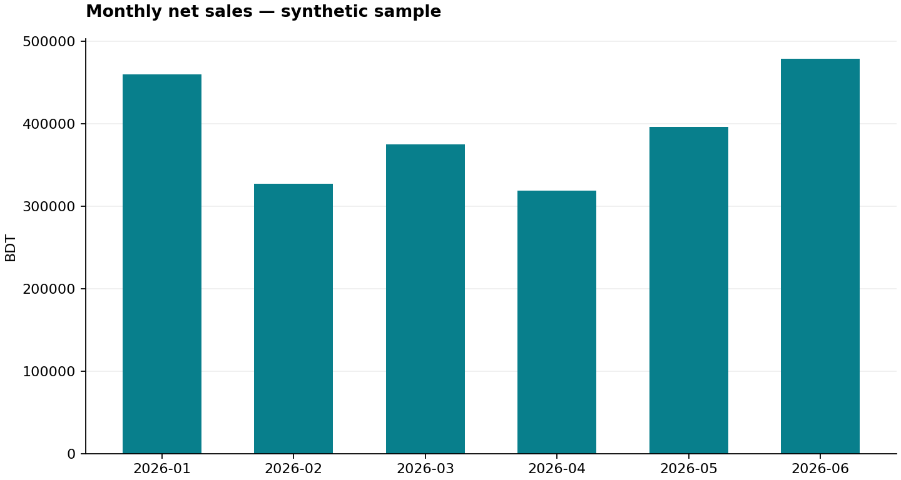

# Retail Sales Analytics

**A small data analyst portfolio project by Junaed Ahmed.**

Turn messy sales CSVs into an audited dataset, SQL analysis, an interactive offline dashboard, an Excel workbook, and Power BI / Tableau-ready exports.

[Repository](https://github.com/junayedtiy4378/retail-sales-analytics) · [Portfolio](https://junaed-ahmed.vercel.app) · [Bootcamp](https://youtu.be/PSNXoAs2FtQ)

## Business questions

1. Which month, region, and category generate the most sales?
2. Which categories generate gross profit rather than revenue alone?
3. Who are the leading customers within each region?
4. How do returns affect the order mix?
5. Can independent SQL and Pandas calculations produce the same results?

All data is **original, synthetic, and denominated in Bangladeshi taka (BDT)**. It is suitable for practice, not for making real business claims. The six-month sample is fixed; there is no live data feed.



See [sample findings](docs/SAMPLE_RESULTS.md). Run the pipeline to explore the interactive dashboard and regenerate every result.

## What this project demonstrates

| Bootcamp skill | Implementation |
| --- | --- |
| Python / Pandas | CSV ingestion, validation, cleaning, joins, grouped analysis, exports |
| SQL | Joins, CASE, GROUP BY, HAVING, CTEs, subqueries, window functions |
| Data quality | Rejected-row audit, duplicate checks, reference-key checks |
| Visualization | Interactive HTML dashboard and three Matplotlib charts |
| Excel | Tables, summary sheets, formulas, an embedded chart, PivotTable practice |
| Power BI / Tableau | Flat and dimensional CSV exports, measures, and build instructions |
| Automation | GitHub Actions tests and downloadable report artifacts |

SQLite is bundled with Python, so no SQL Server, PHP, database service, or API key is needed. SQL syntax is SQLite, not SQL Server T-SQL. Native Power BI `.pbix` and Tableau workbook files are **not included**; follow the BI guide to build those yourself.

## Quick start on Windows

Install **Python 3.12**, including its Windows launcher, from [python.org](https://www.python.org/downloads/). Then open **Command Prompt** in the extracted project folder:

```bat
py -3.12 --version
py -3.12 -m venv .venv
.venv\Scripts\python.exe -m pip install -r requirements.txt
.venv\Scripts\python.exe analyze.py
start "" reports\dashboard.html
```

No virtual-environment activation is required. If `py` is missing, finish installing Python with the launcher/PATH options enabled and reopen Command Prompt. If Python 3.12 is installed but you use another command to launch it, use that interpreter to create the virtual environment.

The dashboard opens locally and works offline. Filter by region, category, and month to recalculate KPIs, charts, and top products. No web server is required.

On macOS/Linux with Python 3.12:

```bash
python3.12 -m venv .venv
.venv/bin/python -m pip install -r requirements.txt
.venv/bin/python analyze.py
```

Open `reports/dashboard.html` with a browser.

## Generated outputs

| Path under `reports/` | Purpose |
| --- | --- |
| `dashboard.html` | Self-contained interactive dashboard |
| `sales_analysis.xlsx` | Excel tables, formulas, summaries, and chart |
| `clean_sales.csv` | Flat, readable dataset with BDT measures |
| `rejected_rows.csv` | Source row numbers, original values, rejection reasons |
| `analysis.sqlite` | Related tables, SQL constraints, and analysis view |
| `kpis.json` | Machine-readable summary |
| `findings.md` | Findings calculated from the current input |
| `charts/` | Three PNG charts |
| `sql_results/` | Results from all eight named SQL queries; money is in paisa |
| `bi/` | Fact table and customer/product dimensions |

Generated outputs and local dependencies are ignored by Git. Rerunning the pipeline refreshes its named outputs, without appending duplicate database records. Use the default dedicated `reports` folder; don't store unrelated files there.

## Data and metric definitions

The bundled input has **500 raw rows**, **80 customer IDs**, and **12 products**. Cleaning produces **480 unique valid orders** and audits **20 rejected rows**: 12 repeated order IDs and 8 invalid rows.

- Grain: one row per order, with one product per order.
- Only `completed` orders contribute sales, product cost, and units sold.
- Returned and cancelled orders have zero booked sales and cost in this simplified model.
- Net sales = quantity × unit price × (1 − discount), rounded half-up to one paisa per order.
- Gross profit = net sales − product cost. It excludes shipping, payment fees, taxes, returns handling, and overheads.
- Average order value = net sales / completed orders.
- Return rate = returned / (completed + returned); cancelled orders are excluded.
- Calculations use integer paisa; 100 paisa = 1 BDT. Human-facing exports convert to BDT.
- The first valid occurrence of an order ID is retained. Later occurrences are rejected; there is no event-history reconstruction.

See [the data dictionary](docs/DATA.md) for schemas and cleaning rules. The generated `findings.md` states the limitations and lists suggested next analyses.

## Tests

```bat
.venv\Scripts\python.exe -m unittest discover -s tests -v
```

Tests cover hand-calculated monetary examples, half-up rounding, returns/cancellations, full-discount losses, invalid input, duplicate orders, reference integrity, SQL/Pandas agreement, exported Excel content, and repeat execution. Reports stop if SQL and Pandas totals disagree.

## GitHub Actions

`.github/workflows/analytics.yml` runs on pushes to `main`, pull requests, and manual dispatch. It installs dependencies, runs the tests, generates reports, and uploads a `retail-analysis-reports` artifact.

After pushing:

1. Open **Actions → Test and build analytics reports**.
2. Open a successful run.
3. Download **retail-analysis-reports** from its Artifacts section.
4. Extract it and open `dashboard.html` or `sales_analysis.xlsx`.

This workflow requires no custom secrets. It generates report artifacts rather than committing generated files to your source branch. Artifacts are retained for 14 days; rerun the workflow to generate them again. GitHub-hosted execution is verified only after your own run succeeds.

## Excel, Power BI, and Tableau practice

Follow [the BI exercises](docs/BI_GUIDE.md) to create Excel pivots, Power BI relationships and DAX measures, or Tableau worksheets. The Excel workbook contains formula examples; Python does not calculate Excel formulas, so open it in Excel for recalculation.

## Use your own data

Match the three CSV schemas in `data/raw/`, then run:

```bat
.venv\Scripts\python.exe analyze.py --input path\to\your\csvs --output reports_custom
```

Keep input/output directories separate. Source files are never modified by analysis. Keep real customer information private and review dataset licenses before publishing. This sample only accepts the three documented order statuses and ISO dates.

To regenerate the original synthetic sample, deliberately overwriting the three demo CSVs:

```bat
.venv\Scripts\python.exe scripts\generate_demo_data.py
```

The fixed random seed makes the demo repeatable.

## Publish to your account

See [the Windows push guide](docs/PUSH_GUIDE.md). Suggested new repository: `junayedtiy4378/retail-sales-analytics`. Keep it separate from NeuralPath and your GitHub profile repository.

## Learning context and credits

Inspired by the topics in **Data Analyst Bootcamp for Beginners (SQL, Tableau, Power BI, Python, Excel, Pandas, Projects, more)**, featuring Alex The Analyst:

- [Bootcamp video](https://youtu.be/PSNXoAs2FtQ)
- [Alex The Analyst on GitHub](https://github.com/AlexTheAnalyst)

This is an independently implemented practice project with original synthetic data. It is not an official course submission, certification, or endorsement.

**Maintainer:** [Junaed Ahmed](https://github.com/junayedtiy4378) · [Portfolio](https://junaed-ahmed.vercel.app) · [Email](mailto:junayedtiy437@gmail.com)
